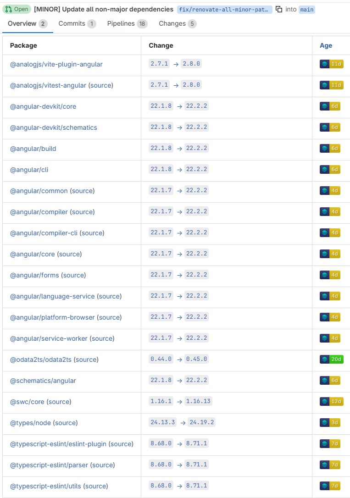

# minimal-reproduction-template

Then replace the current `h1` with the Renovate Issue/Discussion number.

## Current behavior

Dispate having the `minimumReleaseAge` globally at `7 days`, there are MRs created with updates younger then 7 days. 

It seems like the `security:minimumReleaseAgeNpm` preset is not respecting the maximum of the `minimumReleaseAge` and `.npmrc`. 

```
            {
                "internalChecksFilter": "strict",
                "matchDatasources": [
                    "npm"
                ],
                "minimumReleaseAge": "3 days"
            },
```

Running self-hosted on self-hosted GitLab.



## Expected behavior

Only add packages which are at minimumal `7 days` old, not younger. 

## Link to the Renovate issue or Discussion

Put your link to the Renovate issue or Discussion here.
